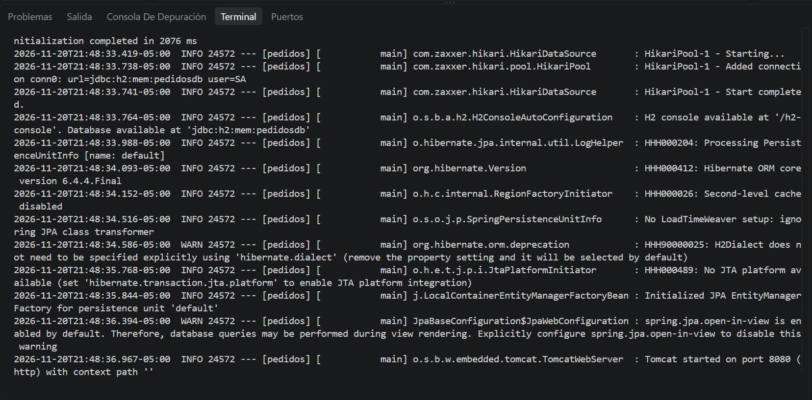
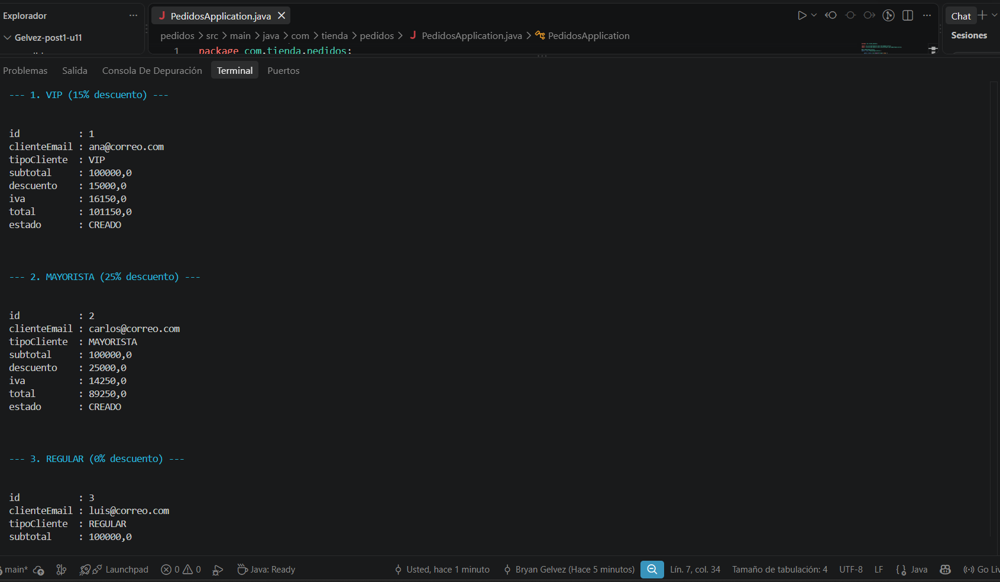
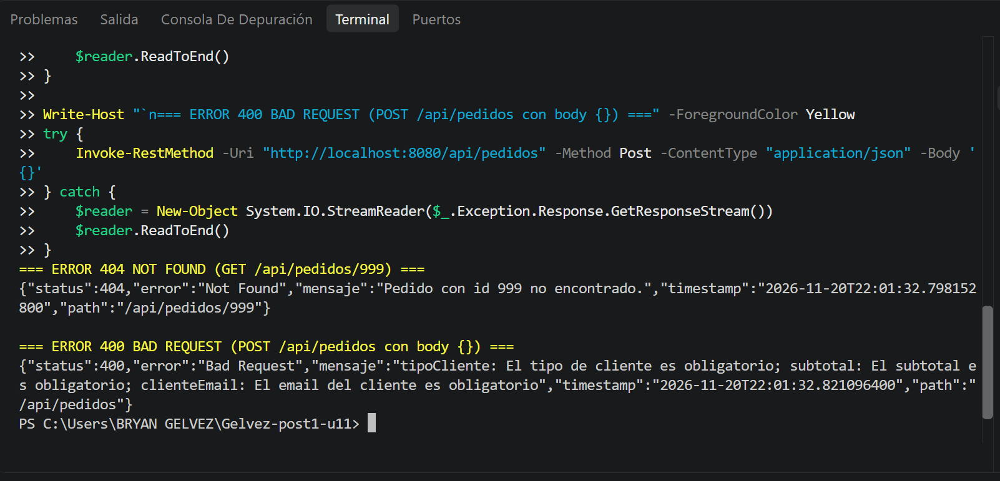
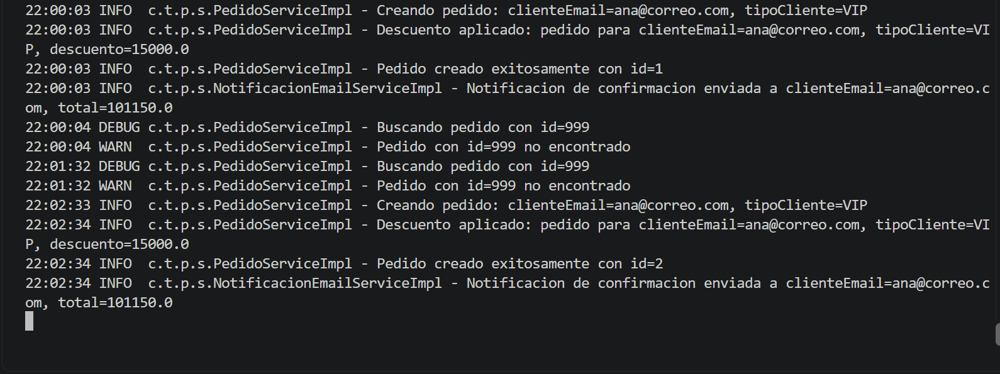
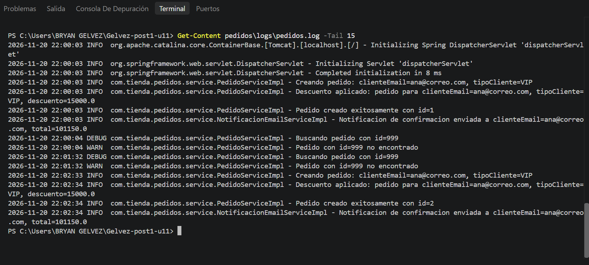
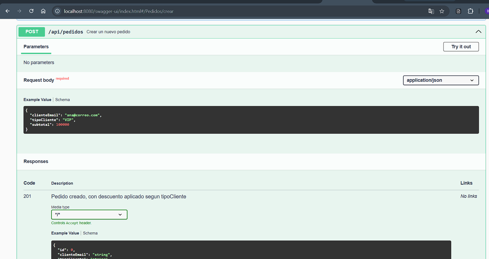

# Post-contenido — Unidad 11: Buenas Prácticas y Patrones de Diseño

## Descripción
Repositorio del laboratorio de la Unidad 11 de Programación Web — Séptimo Semestre. Contiene un único proyecto Maven Spring Boot (\pedidos/\) que parte de un código con violaciones reales de SOLID (SRP y DIP), SQL embebido y una entidad JPA expuesta directamente en la API, y lo refactoriza aplicando arquitectura en capas, el patrón DTO, inyección de dependencias por constructor y el patrón Strategy para el descuento por tipo de cliente. Se extiende con manejo centralizado de errores (\@RestControllerAdvice\), logging estructurado (SLF4J/Logback) y documentación de la API (springdoc-openapi/Swagger).

## Arquitectura en capas resultante (Diagrama de clases)

\\\	ext
+-------------------------------------------------------------------+
|                     CAPA DE PRESENTACIÓN / API                    |
|  PedidoController (@RestController / @Tag)                        |
|   - crear(PedidoRequestDTO) : PedidoResponseDTO                   |
|   - obtener(Long id) : PedidoResponseDTO                          |
|   - listarPorCliente(String email) : List<PedidoResponseDTO>      |
+---------------------------------+---------------------------------+
                                  | depende de abstracción (DIP)
                                  v
+-------------------------------------------------------------------+
|                         CAPA DE SERVICIO                          |
|  <<interface>> PedidoService                                      |
|        ^                                                          |
|        | implementa                                               |
|  PedidoServiceImpl (SLF4J Logger)                                 |
|   - repo : PedidoRepository                                       |
|   - notificador : NotificacionService                             |
|   - estrategias : Map<String, EstrategiaDescuento>                |
+-------+-------------------------+-----------------------+---------+
        |                         |                       |
        v                         v                       v
+---------------+   +---------------------------+   +---------------+
| <<interface>> |   |      <<interface>>        |   | <<interface>> |
|PedidoRepository   |   EstrategiaDescuento     |   |Notificacion   |
|(JpaRepository)|   +---------------------------+   |Service        |
+-------+-------+     ^           ^           ^     +-------+-------+
        |             |           |           |             |
        v       +-----+---+ +-----+---+ +-----+-----+       v
   +--------+   |Descuento| |Descuento| |Descuento  | +-------------+
   | Pedido |   | Regular | |   Vip   | | Mayorista | |Notificacion |
   |(Entity)|   |  (0%)   | |  (15%)  | |   (25%)   | |EmailService |
   +--------+   +---------+ +---------+ +-----------+ +-------------+

+-------------------------------------------------------------------+
|                 MANEJO CENTRALIZADO DE EXCEPCIONES                |
|  GlobalExceptionHandler (@RestControllerAdvice)                   |
|   - RecursoNoEncontradoException  --> 404 Not Found (ApiError)    |
|   - MethodArgumentNotValidException --> 400 Bad Request (ApiError)|
|   - Exception                      --> 500 Internal Error         |
+-------------------------------------------------------------------+
\\\

## Violaciones SOLID y Code Smells corregidos
- **SRP (Single Responsibility Principle) violado en \crearPedido\:** El método original validaba manualmente, calculaba descuentos, construía SQL, persistía, enviaba correos y hacía \System.out.println\ en un solo bloque. Se separaron responsabilidades en \PedidoRequestDTO\ (validación con Bean Validation), \EstrategiaDescuento\ (cálculo), \PedidoRepository\ (persistencia), \NotificacionService\ (notificación) y \PedidoServiceImpl\ (orquestación).
- **DIP (Dependency Inversion Principle) violado con \
ew\:** \NotificacionEmailService\ se instanciaba directamente con \
ew\ dentro del controller. Se extrajo la interfaz \NotificacionService\ y todas las dependencias (\PedidoRepository\, \NotificacionService\, \Map<String, EstrategiaDescuento>\) se inyectan por constructor.
- **SQL embebido y riesgo de inyección SQL:** Se eliminó \JdbcTemplate\ con sentencias SQL concatenadas y se reemplazó por \PedidoRepository extends JpaRepository<Pedido, Long>\.
- **Entidad JPA expuesta directamente en la API:** El controller devolvía \Pedido\ filtrando el campo interno \
otasInternas\. Se crearon \PedidoRequestDTO\ y \PedidoResponseDTO\ con mapeo explícito que omite \
otasInternas\.
- **Manejo de errores disperso:** El \	ry/catch\ en \obtenerPedido\ silenciaba excepciones y retornaba \
ull\ con código \200 OK\. Se reemplazó por \RecursoNoEncontradoException\ capturada centralmente en \GlobalExceptionHandler\ con \@RestControllerAdvice\.

## Decisiones de diseño
- **Strategy en vez de un segundo patrón creacional para la conversión DTO (Parte 1):** El cálculo del descuento tiene variación real de comportamiento según \	ipoCliente\ y es candidato a crecer sin modificar el servicio (OCP). La conversión entidad-DTO, en cambio, es un mapeo 1:1 sin lógica condicional resuelto con un método privado \	oResponseDTO()\ dentro del servicio, evitando sobre-ingeniería.
- **Auditoría del descuento en \PedidoServiceImpl\ (Parte 2):** En lugar de dispersar loggers en cada implementación de \EstrategiaDescuento\, se registra un único evento \INFO\ en \PedidoServiceImpl\ inmediatamente después de aplicar la estrategia, centralizando el rastro de auditoría.
- **Protección de \
otasInternas\ en logs y respuestas (Partes 1 y 2):** El campo \
otasInternas\ es de uso exclusivo de logística; nunca se expone en \PedidoResponseDTO\ ni se incluye en los mensajes de log de SLF4J, registrando únicamente identificadores (\id\, \clienteEmail\, \	ipoCliente\) y montos.

## Parte 1 — Refactorización con SOLID, DTO y Strategy
El código de partida tenía un \PedidoController\ con SQL embebido, un método \crearPedido\ que violaba SRP, una dependencia creada con \
ew\, y devolvía la entidad \Pedido\ completa como JSON. Se extrajeron \PedidoRepository\ (DAO vía \JpaRepository\), \PedidoService\/\PedidoServiceImpl\ (DIP por constructor), \PedidoRequestDTO\/\PedidoResponseDTO\ (sin \
otasInternas\), y el patrón Strategy (\EstrategiaDescuento\ con \DescuentoRegular\, \DescuentoVip\ y \DescuentoMayorista\) inyectado como \Map<String, EstrategiaDescuento>\.

## Parte 2 — Manejo de Errores, Logging y Documentación
\GlobalExceptionHandler\ con \@RestControllerAdvice\ reemplaza el \	ry/catch\ disperso del código de partida, capturando \RecursoNoEncontradoException\ (404), \MethodArgumentNotValidException\ (400) y \Exception\ genérica (500) devolviendo un \ApiError\ uniforme. \PedidoServiceImpl\ registra sus eventos con SLF4J usando placeholders \{}\ y niveles \DEBUG\/\INFO\/\WARN\. \logback-spring.xml\ configura un appender de consola y un \RollingFileAppender\ con rotación diaria y 30 días de historial en \logs/pedidos.log\. La API está documentada con \springdoc-openapi\, accesible en \/swagger-ui.html\.

## Cómo compilar y ejecutar
1. Clonar el repositorio: \git clone https://github.com/BryanGelvez23/gelvez-post1-u11.git\
2. Ejecutar \./mvnw spring-boot:run\ dentro de \pedidos/\
3. Probar los endpoints con Postman o \Invoke-RestMethod\/\curl\ en \http://localhost:8080/api/pedidos\
4. Consultar los logs en consola y en \pedidos/logs/pedidos.log\
5. Abrir la documentación interactiva en \http://localhost:8080/swagger-ui.html\

## Capturas de pantalla

